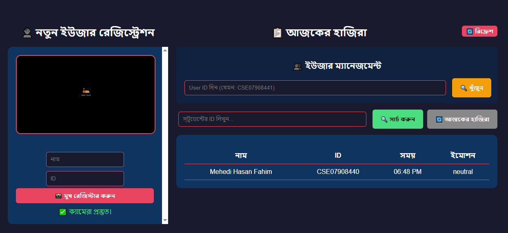

# Smart Attendance System with Face Recognition & Emotion Detection 🤖📸

A modern, AI-powered web-based attendance system that uses facial recognition and emotion detection to mark attendance in real-time. It features a Kiosk mode for users and a secure Admin panel for management. The system greets users with personalized audio messages based on their detected emotion and the current time of day.

## 🚀 Live Demo
- [Kiosk (User Interface)](https://smart-attendance-frontend-mu.vercel.app/)
- [Admin Panel](https://smart-attendance-frontend-mu.vercel.app/admin.html)

## ✨ Key Features
- **Real-time Face Recognition:** Uses `face-api.js` for fast and accurate face matching directly in the browser.
- **Emotion Detection:** Detects user emotions (Happy, Sad, Neutral, Angry, etc.) using pre-trained models.
- **Personalized Audio Greeting:** Uses the Web Speech API to greet users dynamically (e.g., "Good morning, Fahim. You look happy today!").
- **Kiosk Mode:** A clean, distraction-free camera interface for users to quickly mark attendance.
- **Admin Dashboard:** 
  - Register new users with face data.
  - View daily attendance logs.
  - Search specific user attendance history by ID.
  - Update or delete user records.
- **Cloud Database:** Uses TiDB Cloud (MySQL compatible) for secure and scalable data storage.

## 🛠️ Tech Stack
**Frontend:**
- HTML5, CSS3, JavaScript (Vanilla)
- [face-api.js](https://github.com/justadudewhohacks/face-api.js) (TensorFlow.js based facial recognition & emotion detection)
- Web Speech API (For text-to-speech audio greeting)

**Backend:**
- Python 3
- [FastAPI](https://fastapi.tiangolo.com/) (High-performance API framework)
- PyMySQL (Database connector)

**Database & Deployment:**
- [TiDB Cloud](https://tidbcloud.com/) (Serverless MySQL)
- [Render](https://render.com/) (Backend Hosting)
- [Vercel](https://vercel.com/) (Frontend Hosting)

## 📸 Screenshots

### 1. Kiosk Mode (Face Recognition & Greeting)
<!-- এখানে আপনার Kiosk Mode এর ছবি দিন -->


### 2. Admin Panel (Registration & Attendance Logs)
<!-- এখানে আপনার Admin Panel এর ছবি দিন -->


## ⚙️ Architecture & Workflow
1. **Frontend (Browser):** Captures video feed via WebRTC. `face-api.js` processes the video to detect faces and emotions.
2. **Matching:** It compares the captured face descriptor with the stored descriptors fetched from the backend.
3. **Backend (FastAPI):** Receives the User ID and detected emotion. Checks if the user has already been marked present today (cooldown logic).
4. **Database (TiDB):** Stores user face encodings (as JSON arrays) and daily attendance logs.
5. **Audio Output:** If a match is found, the browser uses the Web Speech API to speak the greeting.

## 🚀 How to Run Locally

### 1. Clone the repository
```bash
git clone https://github.com/Mehedi-Hasan-Fahim/smart-attendance.git
cd smart-attendance
```

### 2. Backend Setup
```bash
cd backend
python -m venv venv
# Activate virtual environment
# Windows: venv\Scripts\activate
# Mac/Linux: source venv/bin/activate

pip install -r requirements.txt
```

Create a `.env` file in the `backend` folder and add your database credentials:
```env
TIDB_HOST="your_tidb_host"
TIDB_PORT="4000"
TIDB_USER="your_tidb_user"
TIDB_PASSWORD="your_tidb_password"
```

Run the FastAPI server:
```bash
uvicorn main:app --reload
```

### 3. Frontend Setup
You can use any local server to run the frontend (e.g., Live Server in VS Code).
```bash
cd frontend
# Open index.html (Kiosk) or admin.html (Admin Panel) using Live Server
```

## 👨‍💻 Author
**Mehedi Hasan Fahim**
- GitHub: [@Mehedi-Hasan-Fahim](https://github.com/Mehedi-Hasan-Fahim)
```

---
